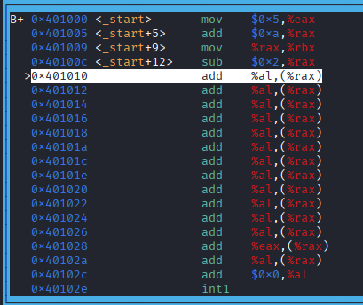

# Beginners Guide to Assembly Language and GDB Debugging

Welcome! This guide documents a step-by-step journey into low-level assembly language programming and debugging using **NASM** and **GDB** on Linux. It is designed to be beginner-friendly and clear enough for non-technical readers while providing accurate technical details.

---

## 💡 What is Assembly Language? (Simple Analogy)

Imagine your computer's Central Processing Unit (CPU) as a chef in a kitchen:
* **High-Level Languages (Python, JavaScript):** Like ordering a meal at a restaurant ("Make me a pizza"). The chef handles all details behind the scenes.
* **Assembly Language:** Like giving step-by-step physical instructions to the chef ("Move hand to shelf, grab 5 grams of salt, put it in bowl").
* **Registers:** These are like the chef's hands—tiny, ultra-fast temporary storage locations inside the CPU used to hold values while performing math or moving data.

---

## 🛠️ Tools Used

1. **NASM (Netwide Assembler):** A program that converts human-readable assembly instructions into binary machine code that your computer understands.
2. **GDB (GNU Debugger):** A tool that allows you to step through your program line-by-line, look inside CPU registers, and watch calculations happen in real-time.

> **Safety Check:** Installing and using NASM is completely safe. It is an industry-standard developer tool and contains no harmful software.

---

## 📜 The Assembly Code Example

Here is the simple arithmetic script written in x86-64 assembly:

```assembly
global _start

section .text
_start:
    mov rax, 5        ; Put the value 5 into register RAX
    add rax, 10       ; Add 10 to RAX (RAX is now 15)
    mov rbx, rax      ; Copy the value of RAX into RBX (RBX is now 15)
    sub rax, 2        ; Subtract 2 from RAX (RAX is now 13)
```

---

## ⚙️ Building and Running the Code

To convert this code into an executable program on Linux, run these commands in your terminal:

```bash
# 1. Assemble the .asm file into an object file
nasm -f elf64 math.asm -o math.o

# 2. Link the object file into an executable file
ld math.o -o math

# 3. Launch GDB to debug the program
gdb ./math
```

---

## 🔍 Debugging with GDB

Once inside GDB, step through the program using these commands:

```text
break _start    # Set a stop point at the beginning (_start)
run             # Start running the program until the breakpoint
stepi           # Execute ONE assembly instruction
info register   # Inspect the current values stored in CPU registers (e.g., info register rax)
quit            # Exit GDB
```

---

## 📊 Understanding the Debugger Output

Below is an annotated image of our program loaded inside GDB:



### Breakdown of What You See in the Image:

1. **Memory Addresses (Left Column, e.g., `0x401000`):**
   * These are the exact addresses in memory where each instruction lives.

2. **The Execution Arrow (`>`):**
   * The `>` marker shows where the CPU is currently paused, ready to run the next instruction.

3. **Intel vs. AT&T Syntax (Right Column):**
   * In our source code, we wrote **Intel Syntax**: `mov rax, 5` (Destination, Source).
   * By default, GDB displays **AT&T Syntax**: `mov $0x5, %eax` (Source, Destination). Numbers have a `$` prefix, and registers have a `%` prefix. Both mean the same thing to the hardware!

4. **Why are there repetitive `add %al,(%rax)` lines at the end?**
   * Assembly code runs sequentially from top to bottom. Because we did not add an explicit **exit system call** (`sys_exit`) at the end of our program, the CPU did not know where to stop.
   * It kept reading random uninitialized memory past our code and tried to interpret it as instructions, which finally led to a crash or execution halt.

---

## 🛑 Key Takeaways

* Assembly language lets you interact directly with CPU registers like `rax` and `rbx`.
* GDB allows you to pause execution and inspect register states line by line.
* Always include an exit system call in production assembly programs so the program terminates cleanly without running into invalid memory.